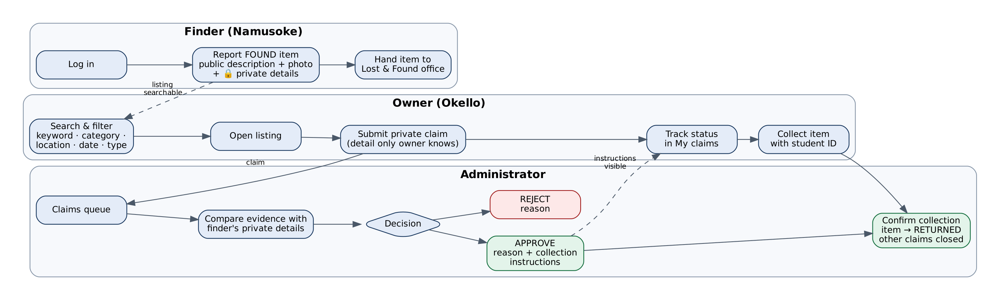
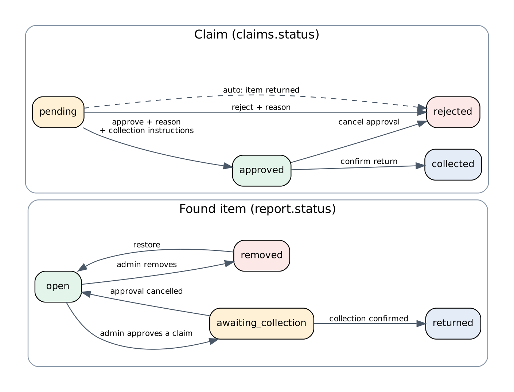
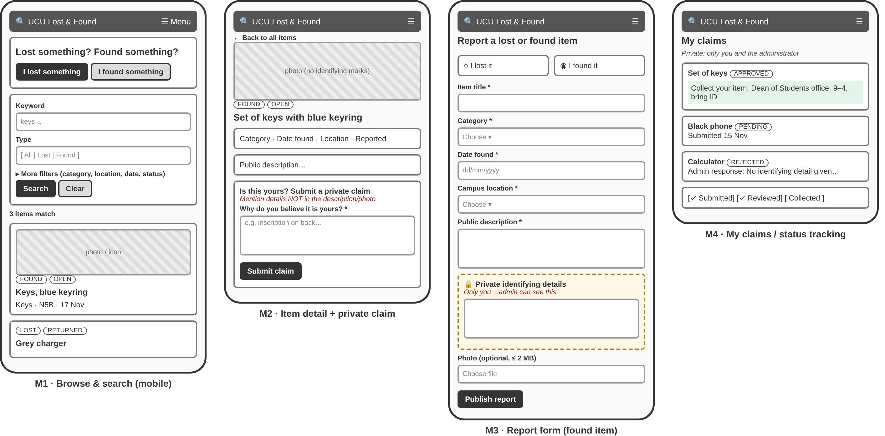
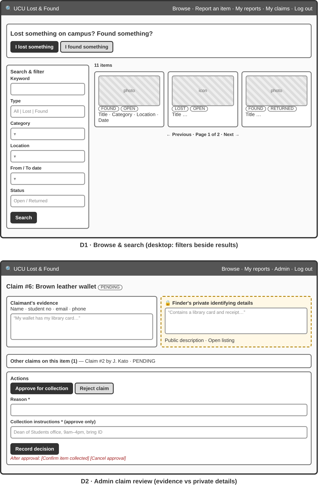
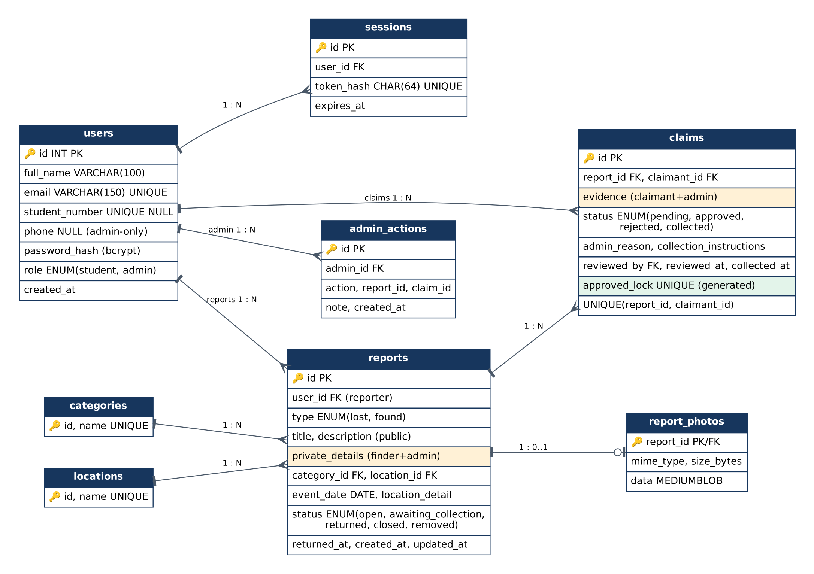
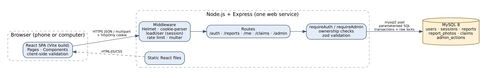

# Milestone 1 — Design Brief

**Project:** UCU Campus Lost-and-Found System  
**Course:** CSC1202 Web and Mobile Applications Development — Advent 2026  
**Group:** _[Group name / number]_ — _[Member names and registration numbers]_

---

## 1. Problem and user needs

At UCU, people who lose things and people who find them post in different WhatsApp groups. Messages get buried, and nobody can reliably check who an item belongs to. In the scenario, Okello lost his keys after a lecture in N5B. Namusoke found them within minutes and posted a photo, but in a group Okello was not in. Even when he saw the photo, there was no fair way to prove the keys were his, no person responsible for checking, and no way to show everyone that the search was over.

| User | Need | How the system meets it |
|---|---|---|
| **Owner** (Okello) | Find out quickly whether his item has been handed in, wherever he is | One shared, searchable listing with filters for keyword, category, location, date and lost/found; works on a phone |
| | Prove ownership without the proof being public | Private claim that only he and the administrator can read |
| | Know what is happening with his claim | "My claims" page showing status, the admin's reason, and collection instructions |
| **Finder** (Namusoke) | Report the item fast and pass it on | Short form with an optional photo; she can hand the item to the office and move on |
| | Make sure only the real owner gets it | A private "identifying details" field (e.g. the inscription on the keyring) that is kept out of the public listing |
| **Administrator** (Lost & Found office) | Decide fairly between claimants | Claim screen shows the claimant's evidence beside the finder's private details, and lists competing claims |
| | Keep a record and close the case | Approve or reject with a required reason; confirm the return only after collection; the listing then shows *Returned* |
| **Everyone** | Privacy and safety | No phone numbers, emails or identifying marks in public responses, enforced on the server |

## 2. Requirements and acceptance criteria

### Functional requirements

| ID | Requirement | Acceptance criteria |
|---|---|---|
| FR1 | Register, log in, log out | A new student can register with a valid email and an 8+ character password with a letter and a number. Wrong credentials show one generic error. After logout, the old session cookie gets **401** on protected routes. |
| FR2 | Role-based permissions on the backend | Students calling `/api/admin/*` get **403**. Editing another student's report gets **403**. Viewing another student's claim gets **404**. |
| FR3 | Create and edit own lost/found reports | A report has type, title, category, public description, date (not in the future), campus location, and an optional JPG/PNG/WebP photo up to 2 MB. Only the owner can edit, and only while it is *open*. |
| FR4 | Private identifying details on found items | Stored separately. Returned **only** to the reporter and the administrator. Never present in list or detail JSON for anyone else. The form warns users to keep these details out of the description and photo. |
| FR5 | Search and filter | Keyword, category, location, date range, lost/found and open/returned filters can be combined. Each result shows a clear status badge (Open, Awaiting collection, Returned, Resolved). |
| FR6 | Ownership claims | Only logged-in students can claim, and only *found* items that are *open*. A student cannot claim their own report, claim the same item twice, or claim a returned item. The claimant sees the status and the admin's response. |
| FR7 | Claim review | The admin approves (reason + collection instructions required) or rejects (reason required). Only **one** approved claim per item is possible (application check + database unique index). |
| FR8 | Confirmed return | "Confirm collected" is only possible for an approved claim. It sets the item to *Returned*, timestamps it, closes competing pending claims, and blocks further claims. |

### Non-functional requirements

| ID | Requirement | Acceptance criteria |
|---|---|---|
| NFR1 | Responsive | Usable at 375 px (phone) and 1366 px (desktop) without horizontal scrolling. Tables become cards on phones. |
| NFR2 | Accessible | Every input has a label. Errors say what is wrong and how to fix it, and are linked from an error summary. Visible keyboard focus, a skip link, and everything usable by keyboard. Text contrast meets WCAG AA (≥ 4.5:1). |
| NFR3 | Persistent | Records and photos survive a server restart (MySQL, photos in a BLOB table). |
| NFR4 | Validated on both sides | The same rules run in React (instant feedback) and Express/zod (authoritative). |
| NFR5 | Secure | bcrypt (cost 12) password hashes, httpOnly SameSite cookies, server-side sessions, parameterised SQL, Helmet headers, login rate limiting, EXIF stripping on photos, no secrets in Git. |
| NFR6 | Clear feedback | Every data view has loading, empty, success and error states. |

## 3. Main workflows

1. **Report found:** Namusoke logs in, chooses *I found it*, enters a general description, photo and location, and puts "inscription D.O. RM 14 on the back" in the **private** field. She then hands the keys to the office.
2. **Search & claim:** Okello filters by *Keys*, *N5B* and yesterday's date, opens the listing and submits a private claim describing the inscription.
3. **Review:** The administrator compares Okello's claim with the private details and any competing claims, then approves with a reason and collection instructions (or rejects with a reason).
4. **Return:** Okello collects with his student ID. The administrator confirms collection, and the listing shows **Returned**.

## 4. Wireframes

**Mobile (375 px)**

**Desktop**

Design decisions:
- **Mobile first:** a single column with a hamburger menu. The less-used filters are collapsed under "More filters" so results appear quickly. On desktop, the filters sit beside the results.
- **Status is always visible** as a coloured badge with a text label (not colour alone).
- **Private fields look different** (dashed amber box with a lock icon) so users can see what is private.
- **The admin sees evidence and private details side by side**, which is the core of a fair decision.

## 5. Database design

- `reports.private_details` and `claims.evidence` are the only sensitive text columns. Public queries use an explicit column list that leaves them out.
- `claims.approved_lock` is a **generated column** that equals `report_id` only when a claim is approved or collected. A `UNIQUE` index on it makes a second approved claim on the same item impossible, even if two admins click at once.
- `UNIQUE(report_id, claimant_id)` stops duplicate claims.
- `sessions` stores a SHA-256 hash of each login token. Deleting the row on logout ends access immediately, which a stateless JWT would not do.
- Photos live in `report_photos` (a BLOB) so free hosting with temporary disks does not lose them, and list queries stay light.
- `admin_actions` is an audit trail of every decision.

## 6. Application architecture

- **React SPA** (Vite) for the user interface. In production it is served by the same Express server, so there is one origin and no CORS or cross-site cookie problems.
- **Express REST API** in layers: middleware (Helmet, session loading, rate limit, uploads) → routes → permission and validation checks → MySQL through a connection pool. Rules that must not race (approve, confirm return, new claim) run in **transactions with `SELECT … FOR UPDATE`**.
- **MySQL 8** for persistence.

## 7. Two-week work plan

| Day(s) | Milestone | Tasks | Output |
|---|---|---|---|
| 1–2 | M1 Design | Analyse the scenario, write requirements, wireframes, ERD, architecture, plan | This design brief |
| 3 | M2 Build | Repo, schema and seed, Express skeleton, DB pool | First commits |
| 4 | M2 | Register, login, logout, sessions, role guards | Auth API + tests |
| 5 | M2 | Report CRUD, photo upload, search filters | Reports API |
| 6 | M2 | Claims, admin review, confirm return, audit log | Claims/admin API |
| 7 | M2 | React layout, browse/search, detail, forms | Student UI |
| 8 | M2 | My reports/claims, admin dashboard and review, integration | Full workflow running |
| 9 | M3 Test | Automated API tests (permissions, privacy, claim rules) | Jest suite |
| 10 | M3 | Manual tests: mobile, keyboard, contrast, validation messages | Test results |
| 11 | M3 | Fix defects, retest, deploy to Render + hosted MySQL | Deployed URL |
| 12–13 | M4 | Slides, rehearse demo and code trace, prepare a local backup | Presentation |
| 14 | M5 | Final report, README check, acknowledgements, submit | Moodle submission |

**Team roles:** _[Fill in. Suggested split: Member A backend & database; Member B React UI & accessibility; Member C testing, deployment & documentation. Everyone should be able to trace one action end to end.]_
